# Thiago Oliveira

Estudante de desenvolvimento de software, aprendendo os fundamentos da programação e criando projetos para praticar.

## Sobre mim

Atualmente, estou desenvolvendo minha base em programação e aprendendo o básico de:

- Lógica de programação
- HTML e CSS
- Java
- Python

## Projetos

- [Show do Milhão em Java](https://github.com/thiagomiranda92/show-do-milhao-java)
- [Café Raízes](https://github.com/thiagomiranda92/cafe-raizes)
- [Orbi](https://orbi-projetos.vercel.app)

## Estatísticas do GitHub

## Contato

- **E-mail:** [thiagomo.miranda80@gmail.com](mailto:thiagomo.miranda80@gmail.com)
